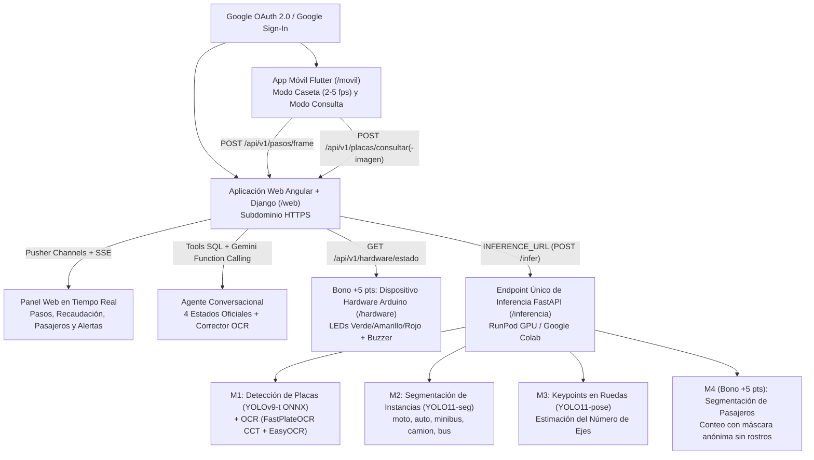

# 🛣️ Sistema Inteligente de Control de Peaje (IAM-811)

**Asignatura:** IAM-811 Machine Learning y Aprendizaje Profundo  
**Docente:** Ing. Alvaro Pinto Mamani (`doc.alvaro.pinto.ma@unifranz.edu.bo`)  
**Autor e Integrante (Modalidad Individual):**
- **Amilkar Hugo Guarachi Nina** (`guamilkar@gmail.com`) — *Arquitectura General, Datasets en Roboflow, Entrenamiento en Google Colab (M1/M2/M3/M4), Endpoint Unificado en RunPod/Colab, Aplicación Web (Django + Angular + Pusher), Agente Conversacional, Aplicación Móvil Flutter y Dispositivo Hardware Arduino.*

---

## 1. Descripción y Arquitectura del Sistema

Sistema inteligente de control de peaje de punta a punta basado en visión por computadora y aprendizaje profundo, ejecutado 100% en infraestructura en la nube (cero recursos locales):



La aplicación web es completamente independiente de dónde corre la inferencia: cambiar entre **RunPod** y **Google Colab** requiere únicamente actualizar la variable de entorno `INFERENCE_URL` en el archivo `.env`.

---

## 2. Estructura del Repositorio

```text
/entrenamiento   Notebooks de Google Colab para M2 (YOLO11-seg), M3 (YOLO11-pose), M4 (Pasajeros) y Roboflow
/inferencia      Servidor FastAPI con los modelos M1 + M2 + M3 + M4, Dockerfile para RunPod y script de diagnóstico
/web             Backend en Django + API REST + Agente Conversacional + Frontend en Angular + Tiempo Real Pusher
/movil           Aplicación móvil en Flutter con Google Sign-In, Modo Caseta (2-5 fps) y Modo Consulta
/hardware        Sketch Arduino Uno/Nano/Mega (.ino) para el bono de conexión física de alertas (+5 pts)
/docs            Colección Postman, especificación OpenAPI/Swagger, Informe Técnico y salidas de diagnóstico
README.md        Documentación general de arquitectura, entornos y despliegue
.env.example     Plantilla de variables de entorno (sin secretos ni API keys expuestas)
```

---

## 3. Tecnologías Utilizadas

| Componente | Tecnología |
|---|---|
| **M1 (Detección de Placas + OCR)** | `YOLOv9-t-384 ONNX` + `FastPlateOCR (CCT-XS ONNX)` + `EasyOCR (CRNN)` |
| **M2 (Segmentación de Instancias)** | `Ultralytics YOLO11s-seg` / `YOLOE-11l-seg` (`moto`, `auto`, `minibus`, `camion`, `bus`) |
| **M3 (Keypoints sobre Ruedas → Ejes)** | `Ultralytics YOLO11s-pose` + agrupamiento espacial de ejes |
| **M4 (Bono +5: Conteo de Pasajeros)** | `Ultralytics YOLO11s-seg` (máscara anónima de ocupantes, sin reconocimiento facial) |
| **Gestión de Datasets y Entrenamiento** | **Roboflow** (Instance Segmentation & Keypoints) + **Google Colab GPU T4** |
| **Endpoint de Inferencia (`INFERENCE_URL`)** | **FastAPI + Uvicorn + ONNXRuntime-GPU + PyTorch** en **RunPod** (+5 pts) o **Google Colab** |
| **Aplicación Web, API REST y Base de Datos** | **Django 5.1 + Django REST Framework + Angular 18 + SQLite/MySQL** en Subdominio HTTPS |
| **Tiempo Real** | **Pusher Channels** + **Server-Sent Events (SSE)** |
| **Autenticación y Roles** | **Google OAuth 2.0 / Google Sign-In** con Lista Blanca (`administrador` y `operador`) |
| **Agente Conversacional** | **Google Gemini Function Calling** + Herramientas SQL determinísticas + Distancia OCR (`O↔0, I↔1, B↔8, S↔5`) |
| **Aplicación Móvil** | **Flutter 3** (`camera`, `google_sign_in`, `image_picker`, `http`) |
| **Hardware de Alerta (Bono +5 pts)** | **Arduino Uno / Nano / Mega** (LEDs de estado, Buzzer de alarma y Servo de barrera) |

---

## 4. Gestión de Entornos con Conda, Mamba o Venv (Bono +5 Puntos)

Cada servicio incluye archivos `environment.yml` y `requirements.txt` con **todas las versiones fijadas (`==`)**, además del script `diagnostico_entorno.py`.

### 4.1 Recrear el entorno del Servicio de Inferencia (`/inferencia`)

**Opción A — Con Conda o Mamba (Recomendado en RunPod / Cloud):**
```bash
cd inferencia
mamba env create -f environment.yml
mamba activate peaje-inferencia
python diagnostico_entorno.py --servicio runpod-inferencia
uvicorn main:app --host 0.0.0.0 --port 8000
```

**Opción B — Con `venv` de Python:**
```bash
cd inferencia
python -m venv .venv
source .venv/bin/activate  # En Windows: .venv\Scripts\activate
pip install -r requirements.txt
python diagnostico_entorno.py --servicio venv-inferencia
uvicorn main:app --host 0.0.0.0 --port 8000
```

### 4.2 Recrear el entorno de la Aplicación Web (`/web/backend`)

```bash
cd web/backend
mamba env create -f environment.yml
mamba activate peaje-web-django
# O con venv:
# python -m venv .venv && source .venv/bin/activate && pip install -r requirements.txt

python manage.py migrate
python manage.py seed_peaje
python ../../inferencia/diagnostico_entorno.py --servicio web-django-cloud
gunicorn peaje_config.wsgi:application --bind 0.0.0.0:8000
```

---

## 5. Instrucciones de Despliegue por Componente

### 5.1 Endpoint de Inferencia en RunPod (+5 pts) o Google Colab
1. **En RunPod:** Crear un Pod con plantilla PyTorch 2.5 CUDA 12.1 (o construir el `inferencia/Dockerfile`), exponer el puerto HTTP `8000` y ejecutar `bash start_runpod.sh`. RunPod asignará una URL pública HTTPS como `https://<pod-id>-8000.proxy.runpod.net`.
2. **En Google Colab:** Abrir `entrenamiento/03_endpoint_inferencia_unificado_colab_runpod.ipynb` con GPU T4 y ejecutar las celdas para obtener la URL HTTPS del endpoint.
3. Copiar la URL obtenida en la variable `INFERENCE_URL` del archivo `.env` del servidor web.

### 5.2 Aplicación Web en Subdominio HTTPS (Hosting Compartido cPanel o Cloud)
1. Configurar el subdominio HTTPS (por ejemplo, `https://peaje.tudominio.com`).
2. Copiar `.env.example` a `.env` y configurar `INFERENCE_URL`, `GOOGLE_CLIENT_ID`, `PUSHER_KEY` y `GEMINI_API_KEY`.
3. Ejecutar `python manage.py migrate` y `python manage.py seed_peaje`.
   - El comando `seed_peaje` autoriza automáticamente como **Administrador** a:
     - `doc.alvaro.pinto.ma@unifranz.edu.bo` (Docente)
     - `guamilkar@gmail.com` (Estudiante)
   - Además registra **24 vehículos de prueba** (incluyendo las 20 placas reales del hito).
4. En **cPanel (Setup Python App)** apuntar el archivo WSGI a `web/backend/passenger_wsgi.py`. En **Cloud (Render/Railway)** utiliza automáticamente el `Procfile` y `build.sh`.

### 5.3 Compilación del APK de la Aplicación Móvil (`/movil`)
```bash
cd movil
flutter pub get
flutter build apk --release
```
El APK instalable se genera en `movil/build/app/outputs/flutter-apk/app-release.apk`.

---

## 6. Enlaces Oficiales del Proyecto

- **Aplicación Web en Producción (Subdominio HTTPS):** *(Colocar URL de tu subdominio al desplegar, ej. `https://peaje.tudominio.com`)*
- **Documentación Interactiva Swagger / OpenAPI:** `https://peaje.tudominio.com/api/docs`
- **Endpoint Unificado de Inferencia (`INFERENCE_URL`):** *(URL de RunPod / Colab en ejecución)*
- **Dataset M2 (Segmentación de Vehículos en Roboflow):** *(Enlace público a tu proyecto de Roboflow M2)*
- **Dataset M3 (Keypoints de Ruedas en Roboflow):** *(Enlace público a tu proyecto de Roboflow M3)*
- **Carpeta en la Nube (Google Drive / OneDrive con Video, Informe PDF y APK):** *(Enlace a tu carpeta compartida con el docente)*
